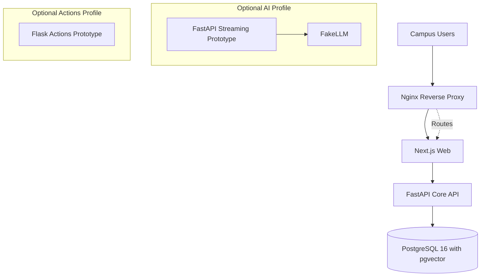

# Kitchen Copilot — Architecture

## 1. Current Docker Compose Architecture

The local development environment defines six services across three optional profiles: `core`, `ai`, and `actions`.

The six running services are:

1. Next.js Web
2. FastAPI Core API
3. PostgreSQL 16 with pgvector
4. Nginx Reverse Proxy
5. FastAPI AI Streaming Prototype
6. Flask Actions Prototype

## 2. Service Responsibilities

- **Next.js Web:** Campus user interface, operational screens and frontend status page.
- **FastAPI Core API:** Authentication, authorization, business logic and REST endpoints.
- **PostgreSQL 16 + pgvector:** Persistent application data and vector storage.
- **Nginx:** Reverse proxy for routing requests to the web application.
- **AI Profile:** Separate FastAPI streaming prototype using FakeLLM; not production AI.
- **Actions Profile:** Separate Flask Actions prototype; not production action execution.

## 3. Compose Profiles

- `core`: Database, API, web application and Nginx.
- `ai`: Optional AI streaming prototype.
- `actions`: Optional Flask Actions prototype.

## 4. Health Checks and Status Monitoring

The following local health endpoints have been verified:

- Core API: `/health` — HTTP 200.
- Core API database health: `/health/db`.
- AI prototype: `/health` — HTTP 200.
- Actions prototype: `/health` — HTTP 200.

The frontend status page is available at `/status`.

The status page checks frontend availability and backend API availability. Both were verified as **Operational** in the local development environment.

Docker Compose reports the database, API, Nginx, AI and Actions services as healthy. The web container is running.

These checks confirm local service availability only. They do not establish production availability or end-to-end verification of every application workflow.

## 5. Current Limitations

- AI and Actions are isolated prototypes, not production integrations.
- Real LLM provider integration and production tool execution are not enabled.
- The AI prototype uses FakeLLM and does not represent a completed production agent.
- Production deployment, backup and recovery require further validation.
- Backup frequency, retention period, recovery-time objective and recovery-point objective must be confirmed with the campus before production handover.
- Production security, monitoring and operational recovery procedures require further verification.

## 6. Week 1 Boundary

This document describes the current Week 1 development architecture. It records locally verified infrastructure and service health without claiming that unimplemented production features are complete.

The successful local health checks do not constitute production deployment, client acceptance or completion of the full Kitchen Copilot system.