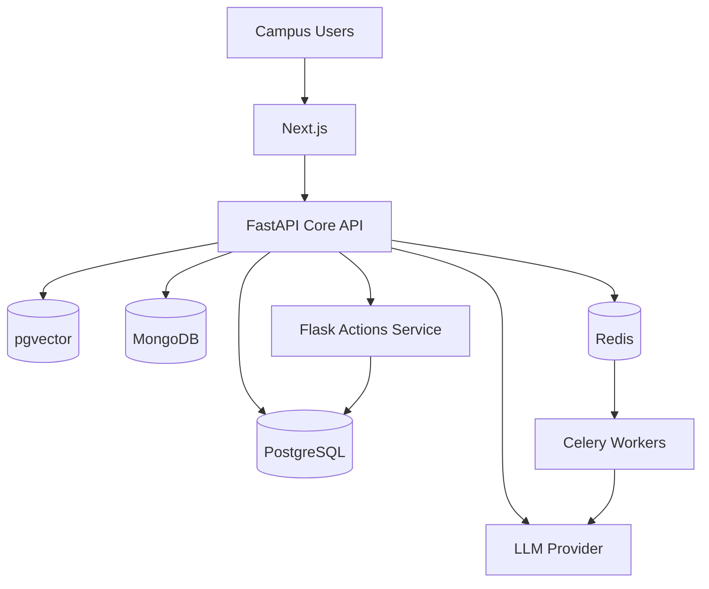

# Kitchen Copilot — Architecture

Next.js provides the interface. FastAPI handles authentication, permissions, campus isolation, business APIs and AI orchestration. PostgreSQL is authoritative for transactions. pgvector supports procedure retrieval. Redis/Celery handle background tasks. Flask Actions validates approved operations. The frontend never calls the LLM directly.
