# Kitchen Copilot — Entity Relationship Diagram (ERD)

## 0. Status of this document

| | |
|---|---|
| Describes | The database **as currently built** |
| Alembic revision | `d4e8a91b2c70` (head) |
| Verified against | The Docker development database (`kitchen_copilot_db`), 16 November 2026 |
| Database | PostgreSQL 16 |
| Primary keys | `integer` (serial) on every table |

This ERD documents what exists today. The approved target design (organizations,
a single platform `SUPER_ADMIN`, purchase orders, stock ledger extensions, meal
planning, prepared food, attendance, hygiene, tasks, alerts and supplier
intelligence) is **not yet implemented**. See section 8 for the planned changes.
Do not treat anything in section 8 as existing.

## 1. Roles (current)

The database role enum `userrole` currently contains exactly three values.

| Role | Access today |
|---|---|
| `ADMIN` | Every campus permission, staff permission assignment, user creation, permanent deletion of master data and waste records |
| `KITCHEN_MANAGER` | The Kitchen Manager permission set (currently defined in code: `services/api/app/api/dependencies.py`) |
| `STAFF` | Only the permissions individually assigned by an `ADMIN` of the same campus |

Every user belongs to exactly one campus (`users.campus_id` is required).

The approved target model adds one platform role, `SUPER_ADMIN` (exactly one
account, no campus, organization management only). It does not exist yet.

### Permission rules

- Permissions are stored as `module.action` codes in `permissions`.
- Allowed actions in the database today: `CREATE`, `READ`, `UPDATE`
  (enforced by `ck_permission_allowed_actions`). There is no `DELETE`
  permission; permanent deletion is restricted to the `ADMIN` role in code.
- `ADMIN` receives every permission row. `KITCHEN_MANAGER` receives a fixed set
  defined in code. `STAFF` receives only active rows in `staff_access_assignments`.
- Unauthorized actions are rejected by the backend, not only hidden in the frontend.

### Modules (9)

`dashboard`, `headcount`, `inventory`, `purchase_order`, `consumption`,
`outsourced_food`, `menu`, `audit`, `waste_tracking`.

Permissions that exist but are not used by any endpoint yet: all
`consumption.*` and `outsourced_food.*` permissions, `headcount.create`,
`headcount.update` and `purchase_order.update`. `headcount.read` and
`audit.read` are used only to show the matching dashboard sections.

## 2. Campus isolation

Every operational table carries a required `campus_id` referencing `campuses`.
API queries filter by the authenticated user's campus. Exceptions without
`campus_id`: `campuses` itself, `modules`, `permissions` and
`staff_access_assignments` (scoped through the staff user's campus).

## 3. Mermaid ER diagram (as built)

To keep the diagram readable, 20 of the 60 foreign keys are shown only as
`FK` columns and are not drawn as relationship lines:

- `campus_id` → `campuses` on `items`, `unit_conversions`, `menus`,
  `menu_main_items`, `purchases`, `purchase_items`, `goods_receipts`,
  `goods_receipt_items`, `stock_movements`, `supplier_payments`,
  `supplier_returns`, `supplier_return_items`, `waste_records` and
  `waste_items` (see section 2);
- user references → `users`: `goods_receipts.created_by`,
  `goods_receipts.accepted_by`, `stock_movements.created_by`,
  `supplier_payments.created_by`, `supplier_returns.created_by` and
  `waste_records.recorded_by`.

```mermaid
erDiagram
    campuses ||--o{ users : employs
    campuses ||--o{ audit_logs : records
    users o|--o{ audit_logs : performed_by

    modules ||--o{ permissions : groups
    permissions ||--o{ staff_access_assignments : granted
    users ||--o{ staff_access_assignments : receives
    users ||--o{ staff_access_assignments : assigned_by

    campuses ||--o{ categories : owns
    campuses ||--o{ units : owns
    units ||--o{ unit_conversions : from_unit
    units ||--o{ unit_conversions : to_unit
    categories ||--o{ items : classifies
    units ||--o{ items : standard_unit
    campuses ||--o{ suppliers : owns
    campuses ||--o{ meal_sessions : has
    meal_sessions ||--o{ menus : session
    menus ||--o{ menu_main_items : ingredients
    items ||--o{ menu_main_items : item
    units ||--o{ menu_main_items : unit

    suppliers ||--o{ purchases : bills
    users ||--o{ purchases : created_by
    purchases ||--o{ purchase_items : lines
    items ||--o{ purchase_items : item
    units ||--o{ purchase_items : unit
    purchases ||--o{ goods_receipts : received_as
    goods_receipts ||--o{ goods_receipt_items : lines
    purchase_items ||--o{ goods_receipt_items : against
    purchases ||--o{ supplier_payments : paid_by
    purchases ||--o{ supplier_returns : returned_against
    supplier_returns ||--o{ supplier_return_items : lines
    purchase_items ||--o{ supplier_return_items : against

    items ||--o{ stock_movements : ledger
    units ||--o{ stock_movements : unit
    goods_receipt_items o|--o| stock_movements : posted_once

    campuses ||--o{ daily_headcounts : counts

    waste_records ||--o{ waste_items : lines
    meal_sessions o|--o{ waste_records : session
    items o|--o{ waste_items : raw_item
    menus o|--o{ waste_items : menu
    units ||--o{ waste_items : unit

    campuses {
        int id PK
        varchar name UK
        varchar code UK
        boolean is_active
    }
    users {
        int id PK
        int campus_id FK
        varchar full_name
        varchar email UK
        varchar password_hash
        userrole role "ADMIN, KITCHEN_MANAGER, STAFF"
        boolean is_active
    }
    audit_logs {
        int id PK
        int campus_id FK
        int user_id FK "nullable"
        varchar action
        varchar entity_type
        int entity_id "nullable"
        json details
        timestamptz created_at
    }
    modules {
        int id PK
        varchar name
        varchar code UK
    }
    permissions {
        int id PK
        int module_id FK
        varchar action "CREATE, READ, UPDATE"
        varchar permission_code UK
    }
    staff_access_assignments {
        int id PK
        int staff_user_id FK
        int permission_id FK
        int assigned_by FK
        boolean is_active
        timestamptz assigned_at
        timestamptz updated_at
    }
    categories {
        int id PK
        int campus_id FK
        varchar name
        varchar description
        boolean is_active
        timestamptz created_at
    }
    units {
        int id PK
        int campus_id FK
        varchar name
        varchar symbol
        varchar dimension "weight, volume, count, other"
        boolean is_active
    }
    unit_conversions {
        int id PK
        int campus_id FK
        int from_unit_id FK
        int to_unit_id FK
        numeric factor "18,6 and > 0"
    }
    items {
        int id PK
        int campus_id FK
        varchar name
        int category_id FK
        int standard_unit_id FK
        numeric minimum_stock "18,3"
        varchar description
        boolean is_active
    }
    suppliers {
        int id PK
        int campus_id FK
        varchar name
        varchar phone
        varchar email
        varchar address
        boolean is_active
    }
    meal_sessions {
        int id PK
        int campus_id FK
        varchar name
        boolean is_active
    }
    menus {
        int id PK
        int campus_id FK
        varchar name
        int meal_session_id FK
        boolean is_active
    }
    menu_main_items {
        int id PK
        int campus_id FK
        int menu_id FK
        int item_id FK
        numeric quantity_per_person "18,3 and > 0"
        int unit_id FK
    }
    purchases {
        int id PK
        int campus_id FK
        int supplier_id FK
        varchar invoice_number
        date purchase_date
        numeric subtotal "18,2"
        numeric discount "18,2"
        numeric extra_charges "18,2"
        numeric grand_total "18,2"
        text remarks
        varchar bill_attachment_path
        varchar status "currently always DRAFT"
        int created_by FK
        timestamptz created_at
    }
    purchase_items {
        int id PK
        int campus_id FK
        int purchase_id FK
        int item_id FK
        numeric quantity "18,3"
        int unit_id FK
        numeric unit_rate "18,4"
        numeric line_total "18,2"
        varchar remarks
    }
    goods_receipts {
        int id PK
        int campus_id FK
        int purchase_id FK
        date receipt_date
        varchar status "DRAFT, ACCEPTED"
        text remarks
        int accepted_by FK
        timestamptz accepted_at
        int created_by FK
        timestamptz created_at
    }
    goods_receipt_items {
        int id PK
        int campus_id FK
        int receipt_id FK
        int purchase_item_id FK
        numeric quantity_received "18,3"
        numeric quantity_accepted "18,3"
        numeric quantity_rejected "18,3"
        varchar remarks
    }
    supplier_payments {
        int id PK
        int campus_id FK
        int purchase_id FK
        date payment_date
        numeric amount "18,2 and > 0"
        varchar payment_method
        varchar reference_number
        varchar remarks
        int created_by FK
        timestamptz created_at
    }
    supplier_returns {
        int id PK
        int campus_id FK
        int purchase_id FK
        date return_date
        varchar status
        numeric credit_amount "18,2"
        text remarks
        int created_by FK
        timestamptz created_at
    }
    supplier_return_items {
        int id PK
        int campus_id FK
        int return_id FK
        int purchase_item_id FK
        numeric quantity "18,3"
        numeric unit_rate "18,4"
        numeric line_total "18,2"
        varchar remarks
    }
    stock_movements {
        int id PK
        int campus_id FK
        int item_id FK
        varchar movement_type "only RECEIPT today"
        numeric quantity "18,3 and > 0, item standard unit"
        int unit_id FK
        int receipt_item_id FK "nullable"
        varchar reference_type
        int reference_id
        varchar remarks
        int created_by FK
        timestamptz created_at
    }
    daily_headcounts {
        int id PK
        int campus_id FK
        date headcount_date
        int student_count ">= 0"
        timestamptz created_at
    }
    waste_records {
        int id PK
        int campus_id FK
        date waste_date
        int meal_session_id FK "nullable"
        int recorded_by FK
        text notes
        timestamptz created_at
        timestamptz updated_at
    }
    waste_items {
        int id PK
        int campus_id FK
        int waste_record_id FK
        int item_id FK "required for RAW_INGREDIENT"
        int menu_id FK "nullable"
        int unit_id FK
        varchar food_name
        varchar waste_type "RAW_INGREDIENT, PREPARED_FOOD"
        numeric quantity "18,3 and > 0"
        varchar waste_stage
        varchar waste_reason
        numeric estimated_cost "18,2"
    }
```

## 4. Constraints enforced by the database

| Table | Unique constraints | Check constraints |
|---|---|---|
| `campuses` | `name`; `code` | — |
| `users` | `email` | — |
| `modules` | `code` | — |
| `permissions` | `permission_code`; `(module_id, action)` | `action IN (CREATE, READ, UPDATE)` |
| `staff_access_assignments` | `(staff_user_id, permission_id)` | — |
| `categories` | `(campus_id, name)` | — |
| `units` | `(campus_id, name)`; `(campus_id, symbol)` | — |
| `unit_conversions` | `(campus_id, from_unit_id, to_unit_id)` | `factor > 0` |
| `items` | `(campus_id, name)` | `minimum_stock >= 0` |
| `suppliers` | `(campus_id, name)` | — |
| `meal_sessions` | `(campus_id, name)` (case-sensitive) | — |
| `menus` | `(campus_id, name)` | — |
| `menu_main_items` | `(campus_id, menu_id, item_id)` | `quantity_per_person > 0` |
| `purchases` | `(campus_id, supplier_id, invoice_number)` | discount, extra charges, subtotal, grand total `>= 0` |
| `purchase_items` | — | `quantity > 0`; `unit_rate >= 0`; `line_total >= 0` |
| `goods_receipt_items` | — | received `> 0`; accepted, rejected `>= 0`; accepted + rejected `<= received` |
| `stock_movements` | `(campus_id, receipt_item_id)` — a receipt line can post stock only once | `quantity > 0` |
| `supplier_payments` | — | `amount > 0` |
| `supplier_return_items` | — | `quantity > 0`; `unit_rate >= 0` |
| `daily_headcounts` | `(campus_id, headcount_date)` | `student_count >= 0` |
| `waste_items` | — | `quantity > 0`; `estimated_cost >= 0`; type, stage and reason lists; RAW_INGREDIENT requires `item_id`; PREPARED_FOOD requires no `item_id` and a non-empty `food_name` |

## 5. Rules enforced only in application code today

- Campus isolation of every query and every referenced record.
- Unit conversions must exist and match dimensions before purchases,
  receipts and menu standards are saved.
- A goods receipt may be accepted only once and only when accepted plus
  rejected quantities equal the received quantity.
- Receipt quantities may not exceed the purchased quantity.
- Only `ADMIN` can create users, assign staff permissions and permanently delete
  records.

## 6. Rules not yet enforced (planned)

- Purchase, receipt, payment and return `status` values are not constrained.
- Stock balances are not calculated; only receipts create stock movements.
- Waste records do not change stock. Prepared-food waste must never change raw
  stock; raw-ingredient waste will post a stock movement once confirmation is
  introduced.
- Payments are not limited to the bill total and not tied to a bill status.
- Inventory may not become negative once kitchen issues exist (policy pending).

## 7. Staff access assignment flow (current)

1. `ADMIN` creates a user account in their own campus.
2. `ADMIN` opens Staff Management.
3. `ADMIN` selects modules and individual actions.
4. The system replaces the staff member's active assignments and records an audit entry.
5. Staff signs in and sees only authorized pages and actions.
6. The backend validates every protected request.

The dashboard is calculated from operational tables. There are no duplicate
dashboard data tables.

## 8. Approved design changes not yet implemented

Summary only; nothing below exists in the database yet.

| Area | Planned change |
|---|---|
| Platform | `organizations` table; `campuses.organization_id`; one `SUPER_ADMIN` account with no campus |
| Accounts | Invitations, revocable refresh tokens, password reset, login throttling |
| Permissions | `role_permissions` table replacing the code-defined Kitchen Manager set; actions extended with `DELETE`, `APPROVE`, `EXPORT`, `RECORD` |
| Master data | Item kind (raw, prepared, outsourced) and expiry flags; five canonical meal sessions via a session code; versioned portion standards |
| Purchasing | `purchase_orders` with lines and an `ORDERED` state; `purchases` remains the supplier bill |
| Stock | Direction, unique source key and effective time on movements; lots; kitchen issues and returns; physical counts; approved adjustments |
| Food | Weekly meal plans; prepared-food balance and leftovers; outsourced food |
| People | Staff attendance; hygiene and uniform checks; kitchen tasks (Pending, Completed, Postponed) |
| Insight | Alerts with recipients, actions and delivery history; supplier metrics; report exports |
| AI | Agent run, step and proposal tables (feature remains disabled) |

All future changes are additive Alembic migrations. Existing records,
migrations and primary key types are preserved.
